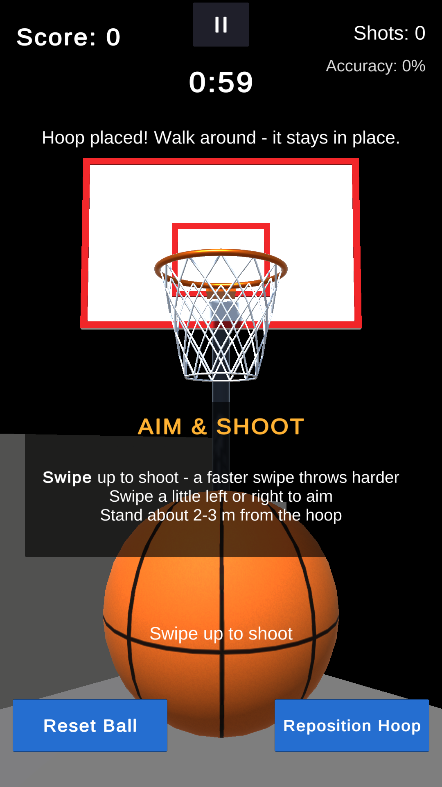
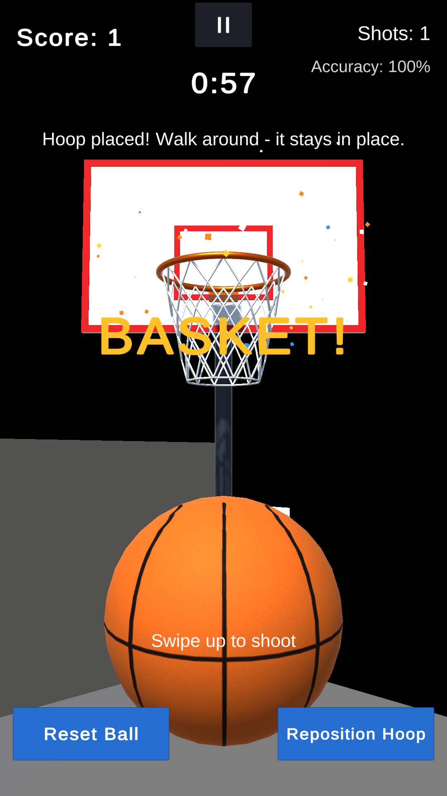
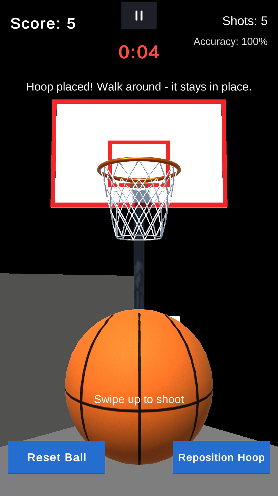
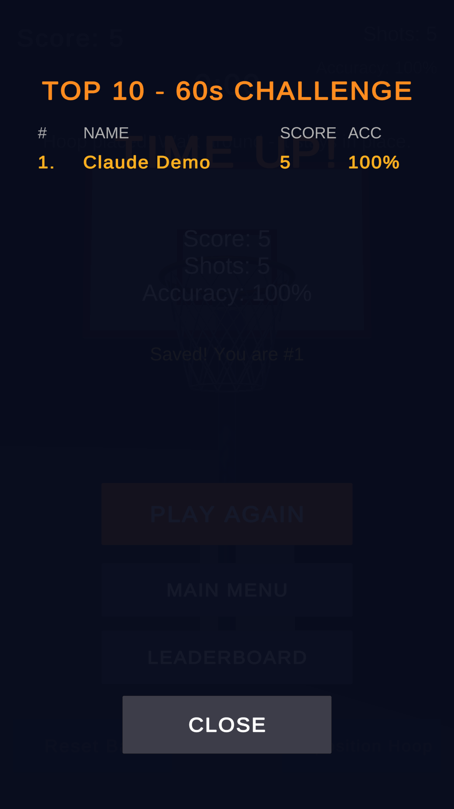

# 🏀 AR Basketball Shooter

An Augmented Reality basketball game for Android.
1. Scan your floor with the phone camera.
2. Place a virtual hoop in your room.
3. Flick the screen to shoot. Baskets score points with sound, confetti and an on-screen celebration.

Built with **Unity 6**, **AR Foundation 6** and **ARCore**, as an Immersive Technologies project.

There is also a **laptop / browser version** (Stage 10) for demos without a phone. It uses a virtual court instead of the camera, with mouse and keyboard controls.

| | |
|---|---|
| ▶ **Play in your browser** | **[shijin286.github.io/ar-basketball-shooter/play](https://shijin286.github.io/ar-basketball-shooter/play/)** – virtual court (browsers have no ARCore) |
| 📱 **Android AR app** | [ARBasketballShooter_v1.0.apk](https://github.com/shijin286/ar-basketball-shooter/releases/latest/download/ARBasketballShooter_v1.0.apk) – needs an [ARCore-supported phone](https://developers.google.com/ar/devices) |
| 💻 **Windows app** | [ARBasketballShooter-Windows.zip](https://github.com/shijin286/ar-basketball-shooter/releases/latest/download/ARBasketballShooter-Windows.zip) – unzip and run `ARBasketballShooter.exe` |
| 🌐 **Project page** | [shijin286.github.io/ar-basketball-shooter](https://shijin286.github.io/ar-basketball-shooter/) |

<p align="center">
  
  
  
  
</p>

*Screenshots from the Unity Editor's XR Simulation (a simulated room).*

---

## Features
| # | Feature | Highlights |
|---|---|---|
| 1 | **AR plane detection** | Horizontal surfaces only, a placement ring, tap to place, Reposition Hoop |
| 2 | **Virtual hoop** | Real-size rim (0.45 m) at 1.6 m height; backboard, 16-capsule rim, net; held in place by an AR anchor |
| 3 | **Basketball** | Real size and mass (0.24 m, 0.6 kg), procedural texture, Continuous Dynamic collisions, realistic bounce, auto-respawn, Reset Ball |
| 4 | **Swipe shooting** | Flick speed → power, sideways flick → aim, `AddForce(ForceMode.Impulse)` clamped to 1.5–5.4 N·s, backspin, one shot per swipe, adjustable aim assist |
| 5 | **Scoring** | A trigger zone inside the rim: a ball must enter from above and leave below. One point per basket, each ball scores at most once, rim/backboard touches and balls from below never count. |
| 6 | **Game UI** | Title screen, Start Game, Place Hoop and Aim & Shoot instructions, score / shots / accuracy, Pause/Resume (also the Back button), Restart, safe-area support |
| 7 | **Audio & effects** | Impact sounds by surface and speed (3D), swish and chime, whoosh, clicks; confetti burst, net stretch, vibration, button press animation |
| 8 | **Delivery** | One-click APK build with settings check, keep-screen-on, mobile performance settings, app icon |
| 9 | **60s Challenge & leaderboard** | Countdown (runs only while playing), last-10-seconds warning, beeps and buzzer, 2 s buzzer-beater grace, results screen, local top-10 leaderboard saved on the phone, name entry |
| 10 | **Laptop & browser version** | Windows `.exe` and WebGL build with a virtual wooden court and walls. WASD to walk, right mouse button to look, click to place, drag up to shoot. Same game scripts; phone UI kept in a centred column; `-autodemo` self-test |

## Technology
| Item | Version |
|---|---|
| Unity Editor | Unity 6 (6000.6.7f1) with Android Build Support (OpenJDK, SDK & NDK); Windows and Web build support for Stage 10 |
| Render pipeline | Universal Render Pipeline (URP) 17.6 |
| AR Foundation | 6.6.2 |
| Google ARCore XR Plugin | 6.6.2 (same major.minor as AR Foundation) |
| Input | Input System 1.20 (touch and mouse through `Pointer`) |
| UI | uGUI + TextMeshPro |
| Language | C# |
| Target | Android 8.0+ (API 26), target API 36, ARM64, ARCore-supported phones; Windows 10/11 64-bit; WebGL 2 browsers |

## Quick start
1. Create a **Universal 3D** project in Unity 6. Switch to **Android**, then install **AR Foundation** and **Google ARCore XR Plugin**.
2. Copy this repository's `Assets/` folder into the project.
3. Build the generated assets from the menu, in this order:
   1. **Tools → AR Basketball → Create Hoop Prefab**
   2. **Tools → AR Basketball → Create Basketball Prefab**
   3. **Tools → AR Basketball → Create Basket Effect**
4. Set up the scene and settings by following `Docs/Stage1…Stage8` in order. Each guide lists the exact hierarchy, Inspector values and button wiring.
5. **Test in the Editor:** enable **XR Simulation** (XR Plug-in Management → Desktop) and press Play.
   - Hold the right mouse button and use WASD to move.
   - Left-click to place the hoop. Drag up with the left mouse button to shoot.
6. **Build:** run **Tools → AR Basketball → Check Build Settings**, then **Build Android APK**. The APK is saved to `Builds/`.
7. **Laptop version:** run **Tools → AR Basketball → Build Windows App (.exe)**. It is saved to `Builds/Windows/ARBasketballShooter.exe` (see `Docs/Stage10_LaptopVersion.md`).
8. **Browser version:** run **Tools → AR Basketball → Build Web Version (WebGL)**. It is saved to `Builds/WebGL/`; serve that folder from any web server, for example GitHub Pages.

## How to play
1. Press **FREE PLAY** (no time limit) or **60s CHALLENGE**.
2. Point the phone at the floor and move it slowly until a grid appears. **Tap** to place the hoop. Stand 2–3 m in front of it.
3. **Flick up** on the screen to shoot. A faster flick throws harder; flick a little left or right to aim.
4. Score as many baskets as you can. Use **II** to pause, **Reset Ball** for a new ball, and **Reposition Hoop** to move the hoop.
5. **Challenge:** the clock starts once the hoop is placed. A shot in the air at the buzzer still counts. A top-10 score asks for your name; see the board with **LEADERBOARD** on the title screen.

## Project structure
```
Assets/
├── Scenes/ARBasketballScene.unity
├── Scripts/
│   ├── ARPlanePlacement.cs      plane detection, placement ring, tap-to-place, AR anchor, reposition
│   ├── BallSpawner.cs           ball in hand, respawn, Reset Ball, invisible floor
│   ├── BasketballController.cs  one ball: Held → Flying → Finished, Launch(), TryMarkScored()
│   ├── BasketballShooter.cs     swipe → impulse, aim assist, one shot per swipe
│   ├── ShotMath.cs              swipe rules, power, direction, clamp, ideal shot (with drag), backspin
│   ├── SwipeGesture.cs          tracks one swipe; flick speed
│   ├── HoopScoreTrigger.cs      basket detection (from above, out below, once per ball)
│   ├── GameManager.cs           score/shots/accuracy, game states (Title, Placing, Playing, Paused, GameOver), challenge clock
│   ├── Leaderboard.cs           local top-10: ranking, JSON save/load, name cleaning
│   ├── UIManager.cs             HUD, timer, panels, instructions, results, leaderboard, basket message
│   ├── SafeArea.cs              keeps UI clear of notches
│   ├── AudioManager.cs          impact/shot/basket/click sounds, 3D voice pool
│   ├── ScoreEffects.cs          confetti, net stretch, vibration
│   ├── ButtonFeedback.cs        button press animation + click
│   ├── MobileSettings.cs        keep screen on, frame rate
│   ├── DesktopMode.cs           laptop version: AR off, virtual court, UI column, mouse instructions
│   ├── DesktopCameraRig.cs      laptop camera: WASD walk, right-mouse look
│   ├── DesktopAutoDemo.cs       "-autodemo" self-test of the .exe with a virtual mouse
│   └── Editor/                  HoopPrefabBuilder, BasketballPrefabBuilder, EffectsPrefabBuilder, AndroidBuilder, WindowsBuilder, WebGLBuilder
├── WebGLTemplates/ARBasketball/ full-window browser page with loading bar and controls
├── Prefabs/                     BasketballHoop, Basketball, BasketEffect, PlacementIndicator, ARPlane
├── Materials/                   Hoop/, Ball/, Physics/ (Physic Materials), Effects/
├── Models/Generated/            RimTorus and HoopNet meshes
├── Audio/                       9 procedurally generated WAV sounds
├── UI/AppIcon.png
└── Tests/Stage1 … Stage10       208 EditMode + 8 PlayMode automated tests
Docs/                            Stage guides 1–10, Project_Report.md
Tools/                           generate_sounds.py, generate_icon.py
```

## Architecture
Scripts talk through C# **events**, so each one does a single job and they stay loosely coupled:
```
ARPlanePlacement ──HoopPlaced/HoopRemoved──▶ BallSpawner, BasketballShooter, GameManager, ScoreEffects
BasketballShooter ──ShotFired──▶ GameManager (shots), AudioManager (whoosh)
        └── BallSpawner.LaunchHeldBall ─▶ BasketballController.Launch ─▶ Rigidbody.AddForce(Impulse)
BasketballController ──Bounced──▶ BallSpawner ──BallBounced──▶ AudioManager (bounce/rim/board)
HoopScoreTrigger ──BasketScored──▶ GameManager ──ScoreChanged/BasketScored──▶ UIManager, AudioManager, ScoreEffects
GameManager ──StateChanged──▶ UIManager (panels), AudioManager (pause sounds)
GameManager.SetState ─▶ enables/disables placement, shooting, spawning; Time.timeScale for pause
GameManager.Tick ──CountdownTick/TimeUp──▶ AudioManager (beeps, buzzer) ──ChallengeFinished──▶ UIManager (results)
UIManager.SaveScore ─▶ GameManager.SubmitChallengeScore ─▶ Leaderboard.Submit (JSON in persistentDataPath)
```

## Testing
Open **Window → General → Test Runner**:
- **EditMode → Run All:** 208 tests.
  - Project and AR settings, scene wiring, prefab sizes.
  - Physics: bounce height, no tunnelling, shots through the hoop from 1.5–4 m.
  - Swipe and shot maths, the game-state machine, UI panels, safe area, sounds, release settings.
  - Challenge clock, buzzer beaters, and leaderboard ranking/saving.
  - Laptop version: court, camera rig, UI column, placement on the court floor, scene wiring.
- **PlayMode → Run All:** 8 tests that fire real balls in Play mode. Clean shots score; rim, backboard, from-below and repeat passes don't.
- **Device tests:** the master checklist in `Docs/Stage8_AndroidBuild.md` §6.
- **Laptop app self-test:** `Builds/Windows/ARBasketballShooter.exe -autodemo` plays itself and writes `AutoDemo/autodemo_result.txt`.

## Documentation
| Guide | Content |
|---|---|
| `Docs/Stage1_Setup_and_PlaneDetection.md` | Versions, project setup, AR scene, plane detection, placement |
| `Docs/Stage2_BasketballHoop.md` | Hoop prefab, colliders, Physic Materials |
| `Docs/Stage3_Basketball.md` | Ball prefab, physics, spawning, Reset Ball |
| `Docs/Stage4_SwipeShooting.md` | Swipe-to-shot pipeline, clamping, aim assist |
| `Docs/Stage5_Scoring.md` | Trigger-based basket detection, GameManager, score HUD |
| `Docs/Stage6_GameUI.md` | Game states, title/instructions/pause/restart, safe area |
| `Docs/Stage7_AudioAndEffects.md` | AudioManager, confetti, button feedback |
| `Docs/Stage8_AndroidBuild.md` | Build, install, performance, full checklist, troubleshooting |
| `Docs/Stage9_ChallengeAndLeaderboard.md` | 60-second challenge, results screen, local leaderboard |
| `Docs/Stage10_LaptopVersion.md` | Windows .exe with a virtual court, controls, 2-minute teacher demo, tests |
| `Docs/Project_Report.md` | Abstract, objectives, methodology, results, future enhancements |

## Credits & licence
- All code, the hoop and ball models, textures, sounds (`Tools/generate_sounds.py`) and the app icon (`Tools/generate_icon.py`) were created for this project, procedurally, with no third-party assets.
- Unity, AR Foundation, ARCore XR Plugin, URP, Input System and TextMeshPro are used under their respective Unity / Google licences.
- Author: [@shijin286](https://github.com/shijin286)
